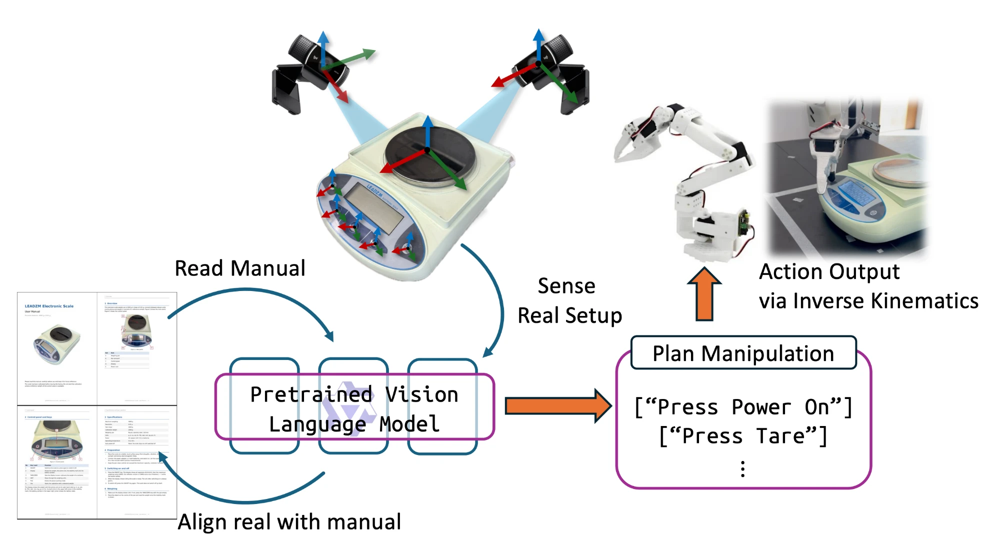

# ByTheBook

Operating appliances and laboratory instruments from their user manuals with a real
robot arm.

ByTheBook carries the ManualPlan method of [CheckManual](https://github.com/LYX0501/CheckManual) (Long et al.,
CVPR 2025) over to a physical robot: a LeRobot SO-101 follower arm with soft fingertips,
three fixed USB cameras calibrated in a common table frame, an optional wrist camera, and
a vision-language model. Given an appliance's user manual (PDF) and a task in plain
English, the robot reads the manual, finds the parts the manual names in the camera
images, plans a short sequence of key presses, presses the keys and reads the display
after every step.

Three ideas are borrowed from the simulation benchmark: manual understanding by a
language model, set-of-mark alignment of manual parts to image regions, and plans in a
restricted operation vocabulary. Everything else (perception on real images, camera
geometry, kinematics, registration, contact-based pressing) is written for the real rig.
ByTheBook shares no code with the benchmark.

The method asks three things of an instrument: a user manual, controls the cameras can
see, and a state that can be read from a display or an indicator. The first instrument is
a 0.01 g precision balance. The operation vocabulary is currently limited to key presses;
knobs, lids and touch screens are what extending it to other laboratory instruments will
add.

<div align="center">
  
</div>

*Overview. A pretrained vision-language model reads the manual, aligns the parts it names
with numbered regions in the camera images, and plans the task as key presses. The aligned
parts are triangulated from the calibrated cameras and pressed through inverse kinematics
with contact detection; the display is read back after every step.*

## Pipeline

`bythebook/pipeline.py` runs the stages below. Every run writes its pictures, `log.txt` and
`report.json` to `results/<timestamp>/`.

1. **Manual reading** (`vlm.py`). The PDF is given to the language model, which returns
   the appliance name, a short prompt for the object detector, and the list of parts a
   user touches or reads (name, kind, printed label, function, location). The answer is
   cached under `results/manual_cache/` by the PDF's hash.
2. **Perception** (`cameras.py`, `perception.py`). The three fixed cameras take 1080p
   stills. GroundingDINO finds the appliance; SAM's automatic mask generator proposes
   candidate parts inside the detection, restricted to the object's own mask. The
   candidates are numbered in reading order and drawn as outlines, with the number placed
   next to small regions so that printed key labels stay legible.
3. **Alignment** (`pipeline.align_views`). For every camera the model is shown the clean
   crop and the marked crop and asked which mark is which part, with a confidence. In the
   overhead view the keys and the display are asked about a second time on an enlarged
   close-up of the control panel; that answer wins for keys.
4. **State and plan** (`vlm.plan`). The model first reads the display from close-ups cut
   around the display mark in each view, then plans the task from that state as steps of
   the form `part: operation x times`, each with the display state expected a few seconds
   later. Operations: `press` and `press_and_hold` (robot), `operator_places` and
   `operator_removes` (a human helper, prompted at the terminal) and `read_display`.
5. **Localisation** (`pipeline.locate`, `geometry.py`). The overhead camera is the anchor:
   its mark is trusted, and in every other view the mark is chosen geometrically as the
   one whose centre triangulates with the anchor mark; the combination of side marks that
   agrees best across all views wins. Without an anchor, two or more views must agree
   within a reprojection tolerance. A part seen in one view only is placed on a known
   surface height (`--surface-z-mm`) or at the height of the parts already located, and a
   part whose height stands out from the others is re-located at their height.
6. **Execution** (`arm.py`). Inside a `Session`, the arm moves at 10 cm above the table,
   across to the key, and down to a hover point 25 mm above it. There the commanded pose
   is corrected in closed loop on the encoders (gravity sag) and, with `--wrist-servo`,
   from the wrist camera. The descent runs at 6 mm/s with contact detection from the
   fingertip stalling behind the command together with a servo load rise; after contact
   the arm keeps pushing until the load has risen by 500 units or the command is 18 mm
   below the contact point, then lifts. Between steps the arm lifts and backs off 9 cm so
   the cameras see the display. A per-key landing correction measured on the appliance
   is interpolated over the panel and added to every target.
7. **Verification and replanning** (`pipeline.execute_plan`, `run_with_replanning`). After
   each step the model reads the display without being told the expectation, and a
   separate text-only request compares the reading with it; a failed check is repeated
   once after another settling pause. If a step still fails, the model is asked once for
   a new plan from the observed state and execution continues; if the failed press did
   make contact, the push force and depth are raised for the retry.

Without `--execute` nothing moves: the run stops after localisation, draws the press
targets into `targets_<role>.jpg`, and simulates the presses with a kinematic stand-in
started from the arm's current pose.

## Requirements

Hardware and calibration inputs, all produced outside this package:

| Input | Location | Produced by |
|---|---|---|
| Camera roles, device paths, arm serial port | `~/rig_map.json` (`RIG_MAP`) | rig setup |
| Camera intrinsics and table-frame extrinsics at 640x480 | `~/rig_calib/latest.json` (`RIG_CALIB`) | `rig-calibrate` |
| Follower servo calibration | servo EEPROM | `lerobot-calibrate` |

Files derived on this machine by the tools below live in `rig_state/`
(`BYTHEBOOK_STATE_DIR`), which is not under version control.

### Environment

```bash
bash setup_env.sh           # conda env `manualarm`: Python 3.12, torch 2.11 + CUDA 12.8, lerobot 0.6.1
conda activate manualarm
python -m pytest tests -q   # simulated tests, no hardware needed
```

The language model is either the Claude API or a model served on this machine:

```bash
export ANTHROPIC_API_KEY=...     # --vlm claude (default); the model id is read from BYTHEBOOK_VLM_MODEL
bash bythebook/tools/serve_local_vlm.sh   # --vlm local: Qwen3-VL-32B-AWQ through vLLM on port 8000
```

The GroundingDINO and SAM weights are downloaded from the Hugging Face hub on first use.

## Usage

```bash
# plan only: manual reading and planning, no cameras, no arm
python -m bythebook.pipeline --manual appliances/leadzm_scale/leadzm_scale_manual.pdf \
    --task "Switch the scale on and tare it." --plan-only

# dry run: cameras and perception, press targets drawn, presses simulated
python -m bythebook.pipeline --manual appliances/leadzm_scale/leadzm_scale_manual.pdf \
    --task "Switch the scale on and tare it."

# real run with the wrist-camera correction and video recording
python -m bythebook.pipeline --manual appliances/leadzm_scale/leadzm_scale_manual.pdf \
    --task "Switch the scale on and tare it." --execute --wrist-servo --record
```

`--vlm local` uses the locally served model, `--images DIR` replaces the live cameras with
`DIR/<role>.jpg`, `--script FILE` replaces the language model with canned answers, and
`--push-load` / `--push-depth-mm` override the push after contact. `--help` lists the rest.

A run leaves the following in `results/<timestamp>/`:

```text
report.json                 manual, plan, matches, locations, per-step records, status
log.txt
scene_<role>.jpg            captured stills
marks_<role>.jpg            numbered candidate parts
targets_<role>.jpg          press targets projected into each view
step<i>_before_<role>.jpg   pictures before and after every step, plus display close-ups
step<i>_after_<role>.jpg
run_<time>_<role>.mp4       with --record
```

## Rig calibration

Done once per rig, in this order. Nothing moves the arm without `--execute` followed by
typing `go` at the prompt.

| Step | Command | Result |
|---|---|---|
| 1. Adopt the servo calibration | `python -m bythebook.tools.adopt_servo_calibration` | `rig_state/arm_calibration/follower.json`; nothing is written to the servos |
| 2. Map the 1080p mode onto the calibrated mode | `python -m bythebook.tools.probe_hires` | `rig_state/hires.json` |
| 3. Check the cameras | `python -m bythebook.tools.check_rig` | reprojection, height and scale report for a board lying on the table |
| 4. Rough registration by hand | `python -m bythebook.registration collect` | arm limp, the closed gripper tip placed on numbered board corners; 3 to 5 mm, enough to move safely |
| 5. Marker registration | `python -m bythebook.tools.marker_registration run --execute` | a small ChArUco board taped to the gripper is shown to the cameras in 40 joint-space poses; base pose, board pose and three joint zero offsets are fitted (1.4 mm residual on this rig) |
| 6. Tip measurement | `python -m bythebook.tools.tip_touchup run --execute --ruler` | the arm presses board corners and holds; the fingertip offset is measured with a ruler, or clicked in the pictures without `--ruler` |
| 7. Rest pose | `python -m bythebook.arm set-rest` | the pose the arm returns to at the end of every session, recorded with torque off |
| 8. Press test without the language model | `python -m bythebook.tools.press_mark --prompt "kitchen scale" --execute` | pick a part by mark number in each view, triangulate, press; `--measure-bias` stores a per-key landing correction |
| 9. Wrist-camera correction | `python -m bythebook.tools.wrist_servo calibrate --key X Y Z --execute` | image Jacobian from four 10 mm moves and the reference pixel from one ruler measurement; `check` presses another key with the correction |

If the servos are recalibrated later with `lerobot-calibrate`, run
`python -m bythebook.tools.recalibrated` to carry the registration over to the new joint
zeros; until then the pipeline refuses to connect.

## Motion parameters

Defaults in `arm.Limits`, chosen on the LEADZM scale:

| Parameter | Value | Meaning |
|---|---|---|
| `travel_z` | 100 mm | height of free-space moves above the table |
| `floor_z` | 15 mm | no free-space path may bring the fingertip lower |
| `x_range`, `y_range` | 100 to 300 mm, -180 to 180 mm | workspace box in the base frame |
| `press_speed_mm_s` | 6 | descent speed |
| `contact_threshold`, `stall_mm` | 30 load units, 1 mm | contact = load rise and fingertip stalling behind the command |
| `press_load`, `press_depth_mm` | 500, 18 | push after contact until either is reached (`--push-load`, `--push-depth-mm`) |
| `servo_max_mm` | 15 | largest wrist-camera correction accepted |
| `RealArm.position_p` | 32 | servo position gain written at connection; lerobot's default of 16 is too soft to press |

Pressing is straight down. A plane fitted through the keys (`--fit-panel`) or a fixed tilt
(`--approach-tilt-deg`) remain available for experiments; on this scale a tilted push made
the fingertip slide.

## Safety

- Torque is only enabled with `--execute` and a typed `go`; every other connection is read-only or limp.
- Each free-space path is checked end to end by forward kinematics before the first command is sent: the fingertip stays above `floor_z` and inside the workspace box, and straight-line moves must be continuous in joint space.
- A descent stops 6 mm below the expected surface when no contact is detected.
- At the end of a session the arm returns to the rest pose before torque is released. If it cannot, torque stays on and a message is printed, so the arm does not drop.

## Package layout

| Module | Purpose |
|---|---|
| `rig.py` | Camera models, file locations, calibration-board definitions |
| `cameras.py` | Still capture by camera role in any video mode |
| `geometry.py` | Rays, plane intersection, triangulation, rigid fits |
| `targets.py` | Board corners measured in the table frame by the cameras |
| `kinematics.py` | Forward and inverse kinematics from the URDF, with joint zero offsets and a custom tip |
| `registration.py` | Base-to-table registration from hand touches; the `Registration` record all tools share |
| `arm.py` | Real and simulated arm I/O, checked moves, contact-detected presses, `Session` |
| `perception.py` | GroundingDINO detection, SAM part proposals, numbered marks |
| `vlm.py` | The five language-model requests and their JSON schemas; Claude, local and scripted backends |
| `wrist.py` | Wrist-camera correction: image Jacobian, key finder, the servo callable |
| `pipeline.py` | The end-to-end flow and its command line |
| `recorder.py` | Multi-camera video recording |

| Tool | Purpose |
|---|---|
| `tools/adopt_servo_calibration.py` | Save the servos' own calibration as a lerobot file |
| `tools/recalibrated.py` | Carry the registration over after `lerobot-calibrate` |
| `tools/probe_hires.py`, `tools/check_rig.py` | Camera mode mapping and camera health check |
| `tools/marker_registration.py`, `tools/tip_touchup.py` | Precise registration and tip measurement |
| `tools/press_mark.py` | Press a part chosen by mark number; measure the landing bias |
| `tools/wrist_servo.py` | Calibrate and check the wrist-camera correction |
| `tools/compare_alignment.py` | Score a model's mark-to-part alignment against ground truth |
| `tools/make_manual.py` | Build a user manual PDF from a JSON spec and photos |
| `tools/serve_local_vlm.sh`, `tools/chat_local.py` | Local model server and a terminal chat with it |

`tests/` holds simulated tests of the kinematics, registration, pressing, localisation,
execution and the wrist correction; `bythebook/assets/so101/` holds the URDF and meshes.

## Appliance material

`appliances/leadzm_scale/` holds the appliance used so far, a LEADZM precision scale:

| File | Content |
|---|---|
| `leadzm_scale.json` | Manual spec: parts, key functions, specifications, error table |
| `leadzm_scale_manual.pdf` | The manual built from the spec with `tools/make_manual.py`; `_text_only` is the figure-free ablation |
| `tasks.json` | Six tasks of increasing horizon |
| `alignment_truth.json` | Ground-truth marks for `tools/compare_alignment.py` |
| `photos/`, `scan/`, `reference/` | Source photographs, a 3-D scan of the scale, manuals of similar scales |

## Status and limitations

- Verified on the rig: camera consistency (triangulated board corners reproject within 0.5 px at 1080p), marker registration (1.4 mm residual), kinematics against placo, and end-to-end runs with the local model in which the ON/OFF key is pressed reliably.
- The arm lands 3 to 5 mm from the modelled position in a pose-dependent direction (backlash, link flex, soft fingertips), so 12 mm keys are missed often enough to matter. The per-key landing correction and the wrist-camera correction address this; the wrist-camera correction is covered by simulated tests but has not yet been calibrated on the rig.
- The Claude backend has not been run end to end on this rig; the local Qwen3-VL-32B backend has.
- A vertical fingertip reaches roughly 10 to 28 cm in front of the base and 15 cm to either side; the appliance's keys must lie inside that area.
- At 1080p the outer 240 px on the left and right lie outside the field of view the intrinsics were calibrated on; keep targets near the image centre.
- The cameras measure the board squares about 1 % larger than printed; registering with the board inside the workspace cancels most of this.

## Reference

The method follows ManualPlan from CheckManual, whose simulation benchmark and code are
published at [github.com/LYX0501/CheckManual](https://github.com/LYX0501/CheckManual):

> Yuxing Long, Jiyao Zhang, Mingjie Pan, Tianshu Wu, Taewhan Kim, Hao Dong.
> *CheckManual: A New Challenge and Benchmark for Manual-based Appliance Manipulation.*
> CVPR 2025 (Highlight).
> [Paper](https://github.com/LYX0501/CheckManual/blob/main/docs/paper/CVPR2025_CheckManual.pdf) | [Repository](https://github.com/LYX0501/CheckManual)
